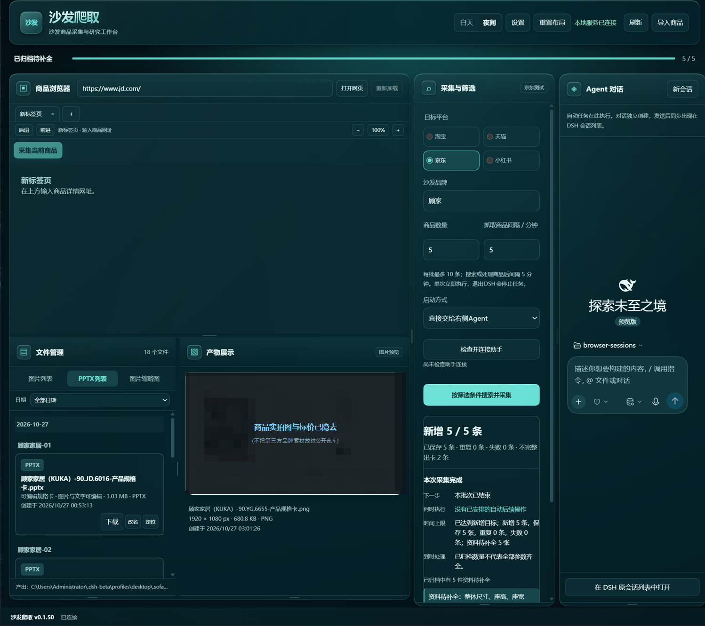
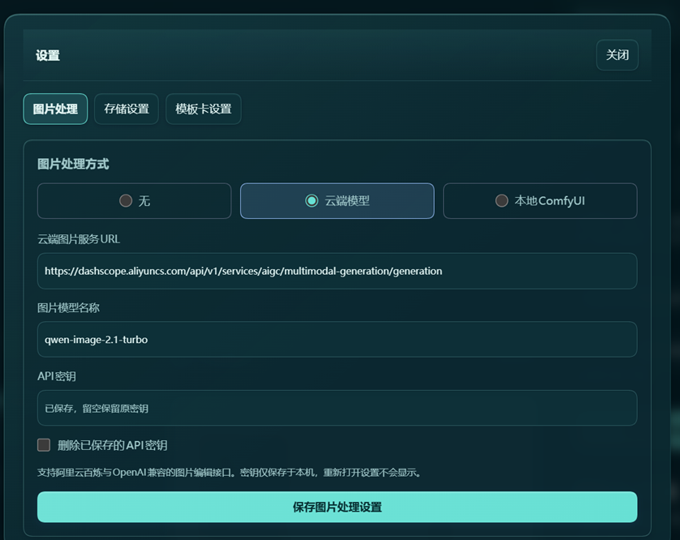

# dsh-京东沙发爬取

> 包名 **`dsh-sofa-monitor`** —— npm 包名、GitHub 仓库名、DSH 里的插件 id 都用它（GitHub 仓库名不支持中文）；插件面板里显示的标题是「沙发爬取」。

一个 **DSH（DeepSeek Harness）插件**：把京东沙发商品页上的标题、品牌、型号、官方规格参数和商品图采集下来，用 AI 图片模型逐张核对详情图，再自动排成 1920×1080 的产品规格卡（PNG + 可编辑 PPTX）并按日期归档。

> 面向家具行业选品、竞品调研、产品资料整理这类**个人/小团队的商品研究**场景。
> 请先读 [合规与免责声明](#合规与免责声明)。

> [!IMPORTANT]
> **跑起来需要三样外部东西同时到位：① Chrome 或 Edge ② DSH 浏览器助手扩展（v0.3.5 / 0.3.6） ③ DSH 浏览器桥工具 `browser_use`。**
> 另外**强烈建议**装 `dsh-computer-use-win`（提供 `mcp__wincu__windows_computer_use_*`），否则界面读取失败时没有桌面补救，只能出「不完整卡片」。
>
> 缺任何一样都跑不起来，详见 [前置要求（先看这个）](#前置要求先看这个)。

---



*主面板：左侧商品浏览器（内置标签页 / 缩放 / 采集当前商品），中间「采集与筛选」+「新增 / 已保存 / 重复 / 失败 / 不完整」统计，右侧独立 Agent 对话；下半部分是文件管理与产物预览。一个批次跑完的样子。*

> 产物区那张规格卡缩略图做了遮挡：里面是第三方品牌的实拍图和页面标价，不适合直接放进来。面板本身、统计数字、文件列表都是真实状态，没有摆拍。



*设置页：无 / 云端模型 / 本地 ComfyUI 三选一。注意密钥框只显示「已保存，留空保留原密钥」——密钥由后台持有，从不回传前端，也不会在这里被读出来。*

---

## 目录

- [合规与免责声明](#合规与免责声明)
- [它到底做什么](#它到底做什么)
- [前置要求（先看这个）](#前置要求先看这个)
- [安装](#安装)
- [配置](#配置)
- [使用](#使用)
- [Agent 工具](#agent-工具)
- [产物与数据目录](#产物与数据目录)
- [隐私与密钥](#隐私与密钥)
- [已知限制](#已知限制)
- [开发](#开发)
- [许可](#许可)

---

## 合规与免责声明

这个插件会**真的去访问电商网站并下载图片**。在用它之前，请明确以下几点：

1. **遵守目标平台的用户协议与 `robots.txt`。** 本项目不承诺你的抓取行为在任何平台、任何地区都合规。合规责任在使用者。
2. **不绕过任何访问控制。** 代码里没有验证码识别、没有登录态伪造、没有风控对抗。遇到登录墙、验证码、403/429、访问频繁提示、权限拒绝时，插件的设计行为是**停止并向你报告**，而不是重试或绕开。
3. **不采隐私数据。** 不读商品评价、评论区、买家秀、问大家，不读账号信息、Cookie、私信，不调用隐藏接口。只读商品详情页上公开的官方参数与商品图。
4. **图片版权不属于本项目。** 采集到的商品图版权归原品牌/平台所有。生成的规格卡仅建议用于内部研究、选品比对；**对外公开发布或商用前，请自行确认授权**。
5. **按你的实际需要设置间隔。** 默认批量间隔 5 分钟、单批最多 10 条，请不要把它改成压测工具。
6. **作者不对使用后果负责。** 详见 [MIT 许可](LICENSE)。

---

## 它到底做什么

一次完整的单品流程：

```
打开京东商品页
   ↓  读官方参数表（不是"已选颜色/尺码"，是真正的参数表）
   ↓  保存详情原图（最多 24 张 / 48MB，单图 8MB 上限）
   ↓  交给图片模型逐批核对（DeepSeek V4.1 Flash 图片路由 / 可选通义千问）
   ↓  按卖点选细节图（扶手、支撑脚、脚托、操控面板…）不同部位各一张
   ↓  排版成 1920×1080 规格卡
   ↓  PNG + 可编辑 PPTX 一起归档，写进当日 CSV 与去重索引
```

几个刻意的设计取舍：

| 取舍 | 原因 |
| --- | --- |
| 座高 ≠ 总高，座宽 ≠ 整机宽，皮料厚度不当作沙发尺寸 | 电商详情图里这几个数字最容易被混用 |
| 参数以官方参数表为准，图片识别不覆盖参数表 | 图片 OCR 会猜，参数表是权威来源 |
| 缺的就说缺，宁可不完整也不编 | 生成器必须能输出"未取得"，否则整套东西不可信 |
| 细节图必须来自真实的不同部位，禁止主图反复裁切凑数 | 三张一样的主图局部等于没有细节 |
| 做完一条就落盘，失败也出"不完整卡片" | 30 分钟跑完才发现在第 29 分钟失败，最亏 |

---

## 前置要求（先看这个）

**这不是"装完就能用"的插件。** 采集链路是「DSH → 浏览器桥 → 浏览器助手扩展 → 真实 Chrome/Edge 标签页」，任何一环缺失都跑不起来。

### 三个硬前提，缺一不可

| # | 前提 | 缺了会怎样 |
| --- | --- | --- |
| **1** | **已安装 Chrome 或 Edge** | 只认标准安装路径（`Program Files` / `Program Files (x86)` / `%LOCALAPPDATA%`）。绿色版、便携版、改了安装位置的一概找不到 → `没有找到已安装的Chrome或Edge，无法自动启动助手浏览器` |
| **2** | **DSH 浏览器助手扩展**（Manifest V3，`background.js` + `panel/index.html`）。**插件自动拉起浏览器时**要求版本是 `0.3.5` 或 `0.3.6` | 采集**本身就是在它驱动的真实标签页里跑的**。扩展没装 / 没连上 → 连接检查停在「未连接」，自动拉起只会开出一个 `about:blank` |
| **3** | **DSH 浏览器桥工具 `browser_use`** | 插件检查连接的第一步就探这个工具，缺失直接抛 `DSH浏览器桥工具未加载；仅打开浏览器不能替代插件加载`。**只装了浏览器、没装桥，一样用不了** |

三条要**同时**在位：缺 ① 装不了扩展，缺 ② 采集没有执行环境，缺 ③ 插件连"看得见浏览器"都做不到。

> **关于版本限制的准确范围**：`0.3.5` / `0.3.6` 这个约束只作用于「插件帮你自动拉起浏览器」这一步。扩展是别的版本时，你**手动**打开助手，只要 `browser_use` 能列出浏览器，采集仍然能跑 —— 只是本插件没验证过其他版本。遇到怪问题先回到 `0.3.5` / `0.3.6` 复现。

> 扩展由 DSH 提供，本插件**不安装扩展、不修改扩展权限**，只负责拉起已装好助手的浏览器并核对真实连接。

### 第四个：强烈建议，但不是必需

| # | 前提 | 缺了会怎样 |
| --- | --- | --- |
| **4** | **`dsh-computer-use-win`**（提供 `mcp__wincu__windows_computer_use_*` 工具组） | 页面读取失败时的**桌面补救通道**。没有它插件照样能采集、能制卡，但补救通道直接禁用 —— 失败的商品只能出「不完整卡片」，缺项如实标注 |

补救实际用到 `list_windows` / `snapshot` / `click` / `scroll` 四个工具，并需要 `tools` 操作能自动启用它们。工具组默认全开；如果你精简过工具集，请确认这四个可用。

### 一张表看全部

| 项目 | 要求 | 必需度 |
| --- | --- | --- |
| 操作系统 | **Windows**。`lib/browser-launch.mjs:16` 非 win32 直接抛错，文件定位与文件夹选择器也是 Win32 | 必需 |
| DSH | `>= 0.2.1-rc.2`（插件内 `minimumBackendVersion` 为 `0.1.48`） | 必需 |
| DSH Desktop 内嵌浏览器适配 | 仅 `2.0.18-beta.1`（版本 + 两个文件 SHA256 校验，见 `assets/native-desktop/host-baseline.json`） | 走「内嵌浏览器」通道时必需；否则用「外部助手」通道 |
| Node.js | `^22.19.0 \|\| >=24` | 必需 |
| Chrome / Edge | 标准安装路径 | 必需 |
| DSH 浏览器助手扩展 | MV3；插件自动拉起限定 `0.3.5` / `0.3.6` | 必需 |
| `browser_use` 工具 | DSH 浏览器桥 | 必需 |
| DSH 图片模型路由 | 能读图的模型（默认走 DeepSeek V4.1 Flash 图片路由） | 必需。详情图核对、卖点识别、选片全靠它 |
| `@napi-rs/canvas` | Windows x64 预编译二进制，`npm install` 时要能拉到 | 必需。规格卡渲染靠它 |
| `dsh-computer-use-win` | `mcp__wincu__windows_computer_use_*` | 强烈建议 |
| PowerShell | 定位文件时现场 `Add-Type` 编译一小段 C# | 可选功能 |
| DSH 文件夹选择器 | 自定义归档目录 | 可选，缺失则落默认目录 |
| 阿里云百炼 API Key | 云端图片处理 | 可选 |
| 本地 ComfyUI | 默认 `http://127.0.0.1:8188` | 可选 |

**图片处理可以完全不配**：设成「无」就只保留官方原图和原视角，商品资料识别、规格卡生成照常跑。

### 装之前自检

按顺序过三关，别跳过：

```powershell
# 关 1：浏览器认不认得
Test-Path "$env:ProgramFiles\Google\Chrome\Application\chrome.exe"      # Chrome
Test-Path "${env:ProgramFiles(x86)}\Microsoft\Edge\Application\msedge.exe"  # Edge
```

```text
关 2：在 DSH 里问一句 —— "browser_use 现在连了几个浏览器？"
      回 "No browser extension is connected to the bridge..." → 扩展没开，去点开助手侧边栏
      回 以 "Connected browsers:" 开头的一行行                → 通了

关 3：在 DSH 里问一句 —— "用 windows_computer_use 的 list_windows 看看有几个窗口"
      能列出窗口   → 桌面补救可用
      报工具不存在 → 补救不可用（不阻塞采集，但质量会降）
```

三关都过不了就别急着采集，先修前提。

---

## 安装

### 方式一：从仓库直接装（推荐用于开发）

```powershell
git clone https://github.com/LZM2023/dsh-sofa-monitor.git
cd dsh-sofa-monitor
npm install
```

然后用 DSH 官方 CLI 把这个目录装进目标 profile：

```powershell
node "<DSH 安装目录>\lib\desktop-cli.js" plugin --profile desktop add "file:D:/path/to/dsh-sofa-monitor"
```

### 方式二：打成 tgz 再装

```powershell
git clone https://github.com/LZM2023/dsh-sofa-monitor.git
cd dsh-sofa-monitor
npm install
npm pack            # 生成 dsh-sofa-monitor-0.1.50.tgz
```

```powershell
node "<DSH 安装目录>\lib\desktop-cli.js" plugin --profile desktop add "file:D:/path/to/dsh-sofa-monitor-0.1.50.tgz"
```

### 方式三：带备份与校验的安装脚本

仓库附带了 `scripts/install-windows.ps1`，它会先备份 profile 的 `package.json` / `cordis.yml` 等配置文件到 `.sofa-monitor/backups/install/<日期>/`，再调用 DSH CLI 安装，最后校验依赖与 bundle 是否都已注册。

```powershell
pwsh -File scripts/install-windows.ps1 `
  -DesktopEntry "<DSH 安装目录>\lib\desktop-cli.js" `
  -DshHome "<你的 DSH 主目录>" `
  -Profile desktop `
  -PackagePath "D:/path/to/dsh-sofa-monitor-0.1.50.tgz"
```

升级时追加 `-Upgrade`（**不会**删除 `.sofa-monitor` 里的用户数据）。

> ⚠️ **这个脚本会修改 DSH 自己的安装目录。** 装完之后它会自动调用 `repair-desktop.mjs --apply` 和 `repair-browser-helper.mjs --apply`，改写宿主 `lib/preload.cjs`、Electron runtime 和浏览器助手扩展文件 —— 也就是说它写的是 DSH 安装路径（通常在 `Program Files` 下，**需要管理员权限**）。
>
> 两个脚本都做了「版本 + 原文件 SHA256 匹配才写、写前备份、写完回读校验、失败回滚」，不匹配就只 `Write-Warning` 并退出，不强推。**但你要清楚它会动宿主文件。** 不想动的话：跳过方式三，用方式一/二只装 npm 包，然后走「外部浏览器助手」链路。详见 [SECURITY.md](SECURITY.md#需要你注意的地方)。

### 安装后

**正常退出 DSH 再重新打开一次**，然后在左侧插件列表里打开「沙发爬取」。
只刷新前端不足以让后台生效。

---

## 配置

打开插件面板 → 右上角 **设置**，分三块：

### 图片处理

| 模式 | 行为 |
| --- | --- |
| **无**（默认） | 不做任何图片编辑，保留官方原图和原视角。商品资料识别、规格卡生成照常 |
| **云端模型** | 支持阿里云百炼原生接口与 OpenAI 兼容的图片编辑接口。填 HTTPS 服务地址、模型名、API 密钥 |
| **本地 ComfyUI** | 填本机或局域网地址（默认 `http://127.0.0.1:8188`），使用标准图生图工作流。**插件不自动下载模型、不自动安装节点**，需你自己先跑起来并装好 Checkpoint |

云端模式的密钥约束：

- 密钥**只由后台保存在本机**（`image-processing-private.json`），永不回传前端、不写进任何日志或返回体
- 设置页留空表示「保留原有密钥」；显式清除需要走 `clearApiKey`
- 服务地址**不允许**带账号、密钥、查询参数或片段（防止把凭据塞进 URL 里被记录下来）

也可以用环境变量提供密钥，此时无需在界面里填：

```powershell
$env:QWEN_API_KEY = "sk-..."          # 优先
$env:DASHSCOPE_API_KEY = "sk-..."     # 其次
```

### 存储设置

按平台选择归档目录（用 DSH 官方 Windows 文件夹选择器）。选定的目录下会建 `SofaMonitor-jd` / `SofaMonitor-taobao` / `SofaMonitor-tmall` / `SofaMonitor-xiaohongshu` 子目录。
不选则用默认的 `<profile>/.sofa-monitor/exports/<平台>`。

> 活动任务进行中不允许换目录；旧文件不会跟着搬。

### 模板卡设置

内置多套版式，可复制、改名、隐藏/恢复、删除、拖动与拉伸画布区块、调精确坐标与配色，并在设置页直接预览真实商品效果。
模板存在 `<数据目录>/template-library/templates.json`，最多 100 个模板、每个最多 30 个区块。模板是受约束的 JSON，**不执行代码**。

插件级配置（在 profile 的 `cordis.yml` 里可以写）：

```yaml
sofa-monitor:
  dataDir: D:/sofa-data     # 覆盖默认数据目录
```

---

## 使用

### 从面板发起

1. 面板里点 **检查并连接助手**，确认浏览器已连上
2. 选平台（目前只有京东实测可用）、填沙发品牌、商品数量（1–10）、整批最长分钟数
3. 选启动方式：直接启动（交给右侧 Agent）或复制指令（自己发给 Agent）
4. 点 **按筛选条件搜索并采集**

关键词固定为「沙发」。数量 10 表示**新增 10 条规格卡**，不是并行开 10 个 Agent —— 它是一个接一个跑的。

### 从对话发起

直接跟 DSH Agent 说，例如：

```
用沙发爬取，帮我采集京东顾家家居的沙发，先来 1 条
```

Agent 会调用下面这组固定工具，不会自己临时发明流程。

### 批次行为

- 每条商品最多 30 分钟（含读取、图片处理、补救、归档），最后留 1 分钟出卡
- 普通失败：出「不完整卡片」并注明缺项和真实原因，5 分钟后继续下一条
- 登录 / 验证码 / 权限 / 平台拦截：本地出卡后**停止整批**，不再访问
- 连续 5 条判定为重复，或耗尽当前页 30 个候选，批次结束
- 数量凑不满就如实报告实际数量，**不翻页硬凑**

---

## Agent 工具

| 工具 | 作用 |
| --- | --- |
| `sofa_monitor_status` | 只读：本地版本、数据数量、采集状态 |
| `sofa_monitor_connect_browser` | 检查 DSH 浏览器助手连接；未连上时尝试拉起已安装的 Chrome/Edge。**只检查连接，不读网页** |
| `sofa_monitor_batch` | 京东品牌批量任务调度：`start` / `next` / `status` / `stop`。由插件调度器分步调用，不自行循环 |
| `sofa_monitor_product_task` | 单品固定自动流程：`run` / `status` / `stop`。单次立即执行，不受批量间隔限制 |
| `sofa_monitor_list_products` | 只读搜索本地已导入的沙发资料（不联网） |
| `sofa_monitor_get_product` | 只读读取单个商品的完整规格与原文链接 |
| `sofa_monitor_list_materials` | 只读查询已确认保存的小红书研究笔记（作者描述，非官方规格） |

`sofa_monitor_connect_browser` 与 `*_list_*` / `*_get_*` 是纯只读；只有 `batch` 和 `product_task` 会真正发起采集。

---

## 产物与数据目录

默认数据根目录：`<profile>/.sofa-monitor`（可用配置 `dataDir` 覆盖）

```
.sofa-monitor/
├── outputs/YYYY-MM-DD/品牌-序号/     # 单件商品的全部产出
│   ├── main.png                      # 主图
│   ├── detail-1..3.png               # 细节图（不同部位）
│   ├── product.json                  # 结构化资料
│   ├── 品牌-型号-产品规格卡.png       # 1920×1080 规格卡
│   └── 品牌-型号-产品规格卡.pptx      # 可编辑 PPTX（文字/图片可分别改）
├── product-tasks/<任务ID>/
│   ├── details/                      # 详情原图本地存档
│   │   ├── index.html                # 离线查询页
│   │   ├── snapshot.json             # 参数原文、来源、原图索引、哈希
│   │   ├── detail-original-XX.avif   # 下载到的原始文件
│   │   └── review-prompt.txt / review.json   # 实际阅读指令与模型返回
│   └── manifest.json
├── exports/<平台>/                    # 你指定的归档目录
│   ├── 京东-采集汇总.csv              # UTF-8 BOM + 公式转义，Excel 直接开
│   └── captures/<采集时间>-<任务ID>/
├── collection-index.json             # 跨批次去重索引（备份时别漏了它）
└── template-library/templates.json   # 规格卡模板
```

**去重规则**：同平台同 SKU，或「品牌 + 真实型号 + 非空颜色 + 非空规格」全部相同 → 判定明确重复。
仍会保存本次 JSON 和图片，并标记关联历史记录，但不计入新增。
只有型号相同、标题相同或配置不足 → 只提醒「可能相似」，**不自动删除**。

CSV 字段：时间、平台、标题、品牌、型号、颜色、规格、商品编号、来源链接、重复标记、备注、关联历史来源、归档目录、全部商品字段 JSON。

---

## 隐私与密钥

- **本仓库里没有任何 API Key、token、cookie 或账号凭据。** 密钥只存在于你本机的 `*-private.json` 或环境变量。
- `.gitignore` 已排除 `*-private.json`、`qwen-private.json`、`image-processing-private.json`、`.env*`。
- 采集数据（`product-tasks/`、`outputs/`、`exports/`、`collection-index.json`）同样被排除 —— **真实商品资料不要提 PR**。
- 插件的返回体有一个脱敏函数：URL、`Bearer`、`token` / `cookie` / `authorization` / `password` / `ticket` / `api_key` 值在写进结果前会被替换成 `[已隐藏]` / `[地址已省略]`。
- 来源网址校验会拒绝 URL 里带 `token` / `cookie` / `auth` / `session` / `password` / `secret` 参数的输入。

如果你**在 Issue / PR 里贴了 Key**，请立刻去服务商后台吊销并重新签发 —— 即使删掉了评论，它也已经进过别人 fork 的历史。

---

## 已知限制

写在这里是为了不让人踩坑，也避免夸大：

- **只在京东上做过真实在线验收。** 淘宝/天猫/小红书入口存在但未经同等强度验证，默认不支持或停用。
- **依赖链很长。** Windows + Chrome/Edge + 浏览器助手扩展 + `browser_use` 桥 + 图片模型路由，缺一环就跑不动；完整清单见 [前置要求（先看这个）](#前置要求先看这个)。纯 Linux/macOS 跑不起来。
- **`assets/native-desktop/*.cjs` 是对特定 DSH Desktop 版本的原生宿主适配**，带版本与文件哈希校验。DSH 升级后需要重新核对，脚本会拒绝覆盖不匹配的版本 —— 这是有意为之，不是 bug。
- **规格卡不能替代人工核对。** 参数缺项、页面口径冲突（比如参数表写 2 个电动位、当前选中却是三电动）都会如实标出，需要你自己判断。
- **AI 图片编辑过的图会标注来源。** 不得当作官方摄影图使用，也不能从 AI 图反推尺寸。
- **不保证同批次两条商品是不同实物。** 不同 SKU 可能是同一件东西，缺失或错误的网页参数也无法保证识别。
- **没有自动化测试。** 目前只有语法自检（`npm run check`）。
- **`@napi-rs/canvas@1.0.12` 是原生模块。** `npm install` 需要能取到对应平台（Windows x64）的预编译二进制；离线或受限网络会装不上，此时规格卡无法渲染。
- **「在资源管理器定位文件」会抢一次前台焦点。** `lib/reveal-image.ps1` 会现场用 `Add-Type` 编译一小段 C#，并在最多 10 秒内轮询 `SetForegroundWindow`。企业 EDR 可能告警，用户会觉得窗口被抢。

### 对 DSH 内部实现的依赖

以下几处是**硬编码耦合**，DSH 换版本后可能静默降级而不是报错，排查时先看这里：

| 位置 | 依赖内容 | 失效表现 |
| --- | --- | --- |
| `lib/browser-launch.mjs:23` | 写死浏览器助手扩展版本 `0.3.5` / `0.3.6` | DSH 换到 0.3.7 后，自动拉起浏览器会退化成 `about:blank` |
| `lib/index.mjs:54` | 依赖 DSH 内部端点 `/ext/bridge-config` 取扩展路径 | 取不到时会话不报错，但助手连接一直停在未连接 |
| `lib/index.mjs:23` | `inject: ['webServer']` | 宿主不再注入该服务时插件整体不加载 |
| `assets/native-desktop/host-baseline.json` | DSH Desktop `2.0.18-beta.1` + 两个文件的 SHA256 | 内嵌浏览器适配被拒，回落到外部助手 |

这些都在欢迎 PR 改进的范围里（尤其是把扩展版本从写死改成协商）。

---

## 开发

```powershell
npm install
npm run check       # 对全部 .mjs/.cjs/.js 跑 node --check，不执行模块
npm run pack:check  # 检查 npm pack 会打进哪些文件
```

目录结构：

```
lib/
├── index.mjs              # 插件入口：注册服务、路由、Agent 工具
├── client.js              # 前端面板源码（window.__ModuleLoader__ 包装，可直接改）
├── product-task.mjs       # 单品任务状态机（核心，最大的一块）
├── card-batch.mjs         # 批量任务
├── jd-automatic-reader.mjs# 京东参数/图片读取与校验
├── detail-review.mjs      # 详情图交给图片模型逐批核对
├── photo-selection.mjs    # 按卖点选细节图
├── image-processing.mjs   # 无 / 云端 / ComfyUI 三种图片处理
├── qwen-api.mjs           # 通义千问（识别 + 图片编辑）
├── cloud-images.mjs       # OpenAI 兼容图片编辑接口
├── editable-pptx.mjs      # 生成可编辑 PPTX
├── spec-layout.mjs        # 规格卡排版
├── template-*.mjs         # 模板库、schema、预览
├── storage.mjs            # 落盘、索引、CSV
└── ...
assets/
├── native-desktop/        # DSH Desktop 原生浏览器宿主适配（带版本 + 文件哈希校验）
└── *.md                   # 给 Agent 的流程约束文档
```

历史版本的逐条改动见 [CHANGELOG.md](CHANGELOG.md) 与 [docs/RELEASE-NOTES.md](docs/RELEASE-NOTES.md)。

### 关于截图

README 的界面截图放在 `docs/screenshots/`。

截图里是作者本机的真实采集结果 —— 采集参数、统计数字、文件名、归档路径都是真的，没有摆拍。只有两处做了处理：

- 规格卡缩略图被遮挡（第三方品牌实拍图和页面标价）
- DSH 左侧会话侧栏被裁掉（那是与本插件无关的个人内容）

`docs/screenshots/` 是仓库里**唯一**允许出现图片的地方，CI 的 leak-guard 会拦下其他位置的二进制图。

欢迎 Issue / PR，但请先看 [CONTRIBUTING.md](CONTRIBUTING.md) 与 [SECURITY.md](SECURITY.md)。

改动前建议在本地跑通 `npm run check`。涉及采集流程的改动，请在 PR 描述里写清**是否真的在线验证过**、验证了多少条 —— 没验证过的改动我们会按未验证处理。

---

## 许可

[MIT](LICENSE) © 2026 LZM2023

`assets/LICENSE.dsh-ui-theme.txt` 是 DSH UI 主题色表的上游授权（MIT © 2026 DeepSeek），随本仓库一并保留。
